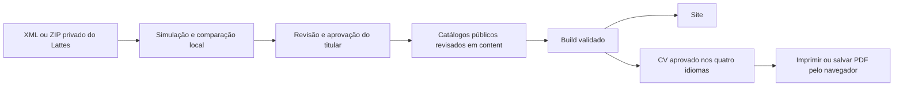

# CV acadêmico resumido: conteúdo e atualização conjunta

## Conteúdo proposto para revisão

1. Identidade e vínculo atual: nome, Departamento de Engenharia Mecânica/UnB, LEA/PCMEC e CNPq PQ-2.
2. Apresentação breve: o texto já aprovado da seção Sobre.
3. Formação: o duplo doutorado já documentado no site. Datas e outras titulações não são inventadas.
4. Pesquisa: as quatro áreas aprovadas da seção Pesquisa.
5. Produção científica: total do catálogo e até cinco artigos escolhidos pelo titular.
6. Formação de pesquisadores: totais de mestrado/doutorado, concluídos/em andamento, incluindo coorientações, calculados apenas dos registros aprovados.
7. Atuação editorial: nomeação editorial ou participação em corpo editorial registrada no catálogo aprovado; o documento não replica todos os pareceres.
8. Contato institucional, ORCID, Lattes e endereço configurado do site. O endereço configurado não comprova que o site esteja publicado.

Esses conteúdos são organizados nos sete tipos de seção de `content/cv.json` (produção e orientação compartilham um bloco de indicadores). Em 15/11/2026, o titular aprovou a seleção abaixo e autorizou a ativação no site local. O estado atual é `approved`. O estado `draft` continua disponível para revisões futuras. O arquivo não mantém cópias dos textos biográficos ou dos metadados dos artigos.

## Seleção aprovada e idioma do visitante

1. Revisão 4E de SAF — Renewable and Sustainable Energy Reviews (2026), DOI 10.1016/j.rser.2026.117194.
2. Otimização de torrefação/biocarvão carbono-negativo — Energy Conversion and Management (2025), DOI 10.1016/j.enconman.2025.120055.
3. Modelagem da torrefação catalítica — Energy (2022), DOI 10.1016/j.energy.2021.122208.
4. Cogaseificação para hidrogênio — International Journal of Hydrogen Energy (2023), DOI 10.1016/j.ijhydene.2023.03.367.
5. SAF de canola com hidrogênio verde — Biomass and Bioenergy (2026), DOI 10.1016/j.biombioe.2026.109149.

O link da seção Sobre aponta para `cv/en.html`, `cv/pt.html`, `cv/fr.html` ou `cv/zh.html` conforme o idioma atual, incluindo a preferência restaurada após recarregar. Não escolhe idioma pelo sistema operacional. A impressão utiliza o conteúdo do documento aberto. Títulos de trabalhos continuam originais. Para manter o CV curto, listas completas de coautores são apresentadas como primeiro autor e *et al.*; o catálogo permanece integral e não foi reordenado.

## Fontes compartilhadas

| Fonte | Uso no CV |
| --- | --- |
| `content/profile.json` | Nome, e-mail institucional e links acadêmicos. Somente campos permitidos são projetados. |
| `content/translations.json` | Vínculo, apresentação, formação, áreas de pesquisa e rótulos em EN/PT/FR/ZH. |
| `content/publications.json` | Total de artigos e metadados atualizados das referências selecionadas. |
| `content/supervisions.json` | Contagens por nível e situação dos registros aprovados. Não envia nomes de estudantes ou títulos provisórios ao CV. |
| `content/editorial.json` | Nomeações editoriais aprovadas, papéis e situação. Não envia notas arbitrárias. |
| `content/cv.json` | Estado editorial e referências bibliográficas escolhidas; limite de cinco artigos. |

## Fluxo de atualização



O XML não é lido pelo gerador do CV nem enviado ao visitante. O importador existente continua usando primeiro `--dry-run`. Orientações, atividades editoriais e mudanças de perfil mantêm seus fluxos próprios de aprovação; importar artigos não atualiza automaticamente todas as outras seções do Lattes.

Uma importação em simulação não altera o CV. Depois da aprovação e incorporação nos catálogos, o mesmo `python -B scripts/build.py` recalcula o site e o documento, sem preencher novamente os mesmos dados. Não foi autorizada nem executada importação nesta etapa.

## Revisão privada

```powershell
python -B scripts/preview_cv.py --output "CAMINHO_FORA_DO_REPOSITORIO/cv-review"
```

Esse comando valida as fontes e gera `en.html`, `pt.html`, `fr.html` e `zh.html`, com aviso editorial. Recusa saídas dentro do repositório ou de `dist/`. Nenhum catálogo é gravado. As prévias podem ser abertas no navegador; o botão Imprimir/Salvar como PDF usa o diálogo nativo. Não há envio de dados a um serviço externo.

## Seleção e aprovação

Um artigo com DOI é referenciado pelo DOI, inclusive quando informado como URL. Exemplo de estrutura, sem escolher um artigo real:

```json
{"doi": "10.1234/exemplo"}
```

Para um artigo sem DOI, use o título original exato e o ano. Se o DOI for acrescentado depois, o documento passa a exibi-lo a partir do catálogo. Se título/ano usados como referência forem alterados, a ausência de correspondência exige revisão, em vez de selecionar outro artigo por suposição.

Novos artigos aumentam o total, mas não substituem automaticamente os artigos escolhidos. Correções bibliográficas nos artigos selecionados são refletidas no próximo build. Referências ausentes, ambíguas ou repetidas interrompem a validação. O ano editorial confirmado de 2022 do DOI 10.1016/j.energy.2021.122208 permanece preservado.

Após aprovação explícita do conteúdo e seleção, `status: "approved"` permite gerar `dist/cv/{en,pt,fr,zh}.html` e incluir um link na seção Sobre, que acompanha o idioma selecionado. O estado aprovado exige seleção não vazia. Enquanto estiver em rascunho, esses arquivos e o link não entram no artefato público.

## Saída e limites desta etapa

- A saída canônica é HTML estático com estilo de impressão A4; o visitante salva o PDF pelo navegador. Não há dependência de navegador ou biblioteca PDF no GitHub Actions.
- Com artigos selecionados, a bibliografia começa em nova página. A extensão final, idealmente duas páginas, dependerá dos artigos escolhidos e deve ser conferida na revisão de impressão. Nesta etapa ainda não foi validada uma versão PDF final de duas páginas.
- O documento inclui data de geração e hash dos conteúdos materializados. Essa data não é a data de atualização do Lattes.
- Os títulos originais dos trabalhos são preservados nos quatro idiomas. A revisão linguística de FR/ZH segue pendente antes da publicação.
- Não há PDF estático independente para envelhecer após uma atualização; um PDF salvo anteriormente pelo visitante continua sendo uma cópia daquela data.
- A prévia não é divulgação pública e a preparação do botão não autoriza publicação no GitHub Pages.

## Testes

`tests/test_cv.py` cobre: quatro idiomas; contagens aprovadas; exclusão de dados privados; bloqueio de rascunhos no build; aprovação condicionada à seleção; referências ausentes/ambíguas/duplicadas; manutenção da seleção ao acrescentar artigo; propagação de correções; DOI acrescentado a trabalho sem DOI; ano confirmado de 2022; geração do link/documentos aprovados e escape de texto no HTML.
